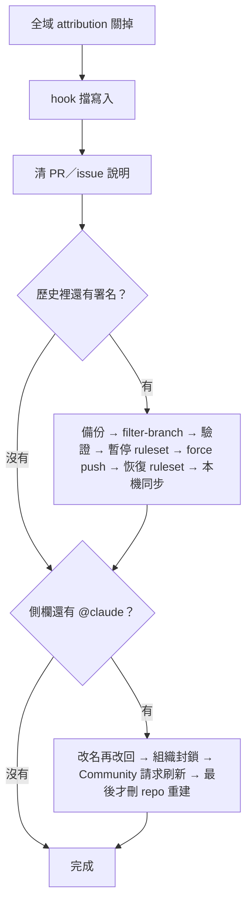

## 發生了什麼

用 Claude Code 產生的 commit，訊息結尾被自動加上兩行：

- `Co-Authored-By` 共同作者行（email 是 Anthropic 的 noreply 位址）
- `Claude-Session` 行：一條 claude.ai 的 session 連結

PR 說明結尾也被加上一行 `Generated with` 開頭、連到 Claude Code 的署名，以及同一條 session 連結。結果：

- repo 首頁右側的 Contributors 出現 `@claude`。這個帳號（id 81847，2009 年註冊）跟 Anthropic 無關；GitHub 把共同作者行的顯示名稱「Claude」對到了它。
- commit、PR、issue 裡留下 session 連結。

## 本 repo 現況

- 2026-09-30 查：側欄列著 `@claude`。
- 步驟 1（全域 `attribution`）已生效，之後的 commit 與 PR 不會再加署名。
- 步驟 2 的 hook 目前只裝在 vendor_kit，本 repo 還沒有。
- 步驟 3～5 尚未在本 repo 做；`@claude` 已在組織層級封鎖。

## 原因

- Claude Code 預設替 commit 與 PR 加署名；關掉要靠設定 `attribution`（舊的 `includeCoAuthoredBy` 已棄用）。
- Contributors 側欄跟 `GET /repos/{owner}/{repo}/contributors` 不是同一份資料：API 只算作者，側欄連共同作者也算，而且會算到已 merge 的 PR 參照（`refs/pull/*`）裡的舊 commit。
- `refs/pull/*` 是唯讀的，repo 擁有者刪不掉；改寫歷史並 force push 之後，舊 commit 仍可從 PR 參照與快取取得。

## 處理步驟（依序）

1. **全域關掉署名**：在 `~/.claude/settings.json` 加

   ```json
   "attribution": { "commit": "", "pr": "", "sessionUrl": false }
   ```

   `commit`、`pr` 設成空字串不加署名；`sessionUrl: false` 不加 session 連結。放在使用者層設定檔，對所有專案生效。
2. **用 hook 擋寫入**（第二道）：PreToolUse hook，commit、`gh pr/issue create|edit|comment`、會寫入的 `gh api` 內容裡有署名或 session 連結就擋下；`-F`／`--body-file` 帶入的檔也查。程式：[attribution_guard.py](https://github.com/ycpss91255-research/vendor_kit/blob/feat/terms-context-hook/.claude/hooks/attribution_guard.py)，在 `.claude/settings.json` 的 `PreToolUse`（matcher `Bash`）註冊。
3. **清 PR 與 issue 說明**：逐一讀出說明，刪掉署名行與 session 連結行，用 `gh api -X PATCH repos/{owner}/{repo}/pulls/{N}`（issue 用 `issues/{N}`）寫回。不動歷史。
4. **改寫 git 歷史**（會改所有 commit hash，要先確認）：
   1. 先 `git clone --mirror` 備份整個 repo。
   2. 在另一份副本上 `git filter-branch --msg-filter` 刪掉 commit 訊息裡的署名行與 session 行；檔案裡若有 session 連結，用 `--index-filter` 一併改。
   3. 驗證：所有分支的訊息與歷史檔案都搜不到，檔案樹只有預期的差異。
   4. 暫停保護 main 的 ruleset → `git push --force` 所有分支（一次推完，main 與其他分支要一致）→ 立刻恢復 ruleset，並逐欄比對設定跟備份相同。
   5. 本機同步：各分支換成改寫後的 commit，`git reflog expire --expire=now --all && git gc --prune=now` 清掉舊物件；確認沒問題再刪備份。
5. **Contributors 側欄**（已知限制，依序試）：
   1. 預設分支改名再改回（[#197389](https://github.com/orgs/community/discussions/197389)）：vendor_kit 試過，15 分鐘內沒效，推測是已 merge 的 PR 參照還留著舊 commit。
   2. 在組織層級封鎖 `@claude`（兩個組織都已封鎖）：官方文件只說被封鎖者的貢獻「不再算給他」，沒說會從側欄消失；vendor_kit 封鎖後 2 分鐘內側欄還在，效果觀察中。
   3. 到 GitHub Community 發文請工作人員手動刷新（[#205652](https://github.com/orgs/community/discussions/205652) 有成功案例）；免費方案的 Support 單會被轉到 Community。
   4. 最後手段：刪掉 repo 再重建（PR 紀錄會全部消失，issue 要先轉移）。

## 流程



## 參考資料

- 官方：[Claude Code 設定參考（attribution）](https://code.claude.com/docs/en/settings-reference.md)
- 官方：[Removing sensitive data from a repository](https://docs.github.com/en/authentication/keeping-your-account-and-data-secure/removing-sensitive-data-from-a-repository)（`refs/pull/*` 唯讀、快取要 Support 清）
- 官方：[Viewing a project's contributors](https://docs.github.com/en/repositories/viewing-activity-and-data-for-your-repository/viewing-a-projects-contributors)
- 官方：[Blocking a user from your organization](https://docs.github.com/en/communities/maintaining-your-safety-on-github/blocking-a-user-from-your-organization)
- 社群：[#197389](https://github.com/orgs/community/discussions/197389)、[#191565](https://github.com/orgs/community/discussions/191565)、[#175200](https://github.com/orgs/community/discussions/175200)、[#202538](https://github.com/orgs/community/discussions/202538)、[#205652](https://github.com/orgs/community/discussions/205652)
- vendor_kit 的處理紀錄：[ycpss91255-research/vendor_kit](https://github.com/ycpss91255-research/vendor_kit)（hook 在 PR #67）

